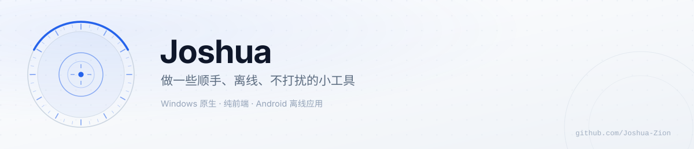

  

  
  
  

我做 Windows 上的效率工具，也写几个纯前端的小玩意。

共同点是离线优先：截图、OCR、录屏、记账、取色都在本机跑完——不用注册，不要账号，删掉文件夹就算卸载。

主要写 C++20 / Win32 和 TypeScript，偶尔用 Python 折腾点视觉的东西。

  

---

## 🧰 项目

### HaloCap · 光圈

**在光标处展开的 Windows 效率工具。** 截图、离线 OCR、贴图、H.264 录屏收进一个光圈菜单——按一下 `F6`，选一项，继续干活。

识别、录制、贴图全部在本机完成：不依赖 FFmpeg，不发起网络请求，也不上传任何东西。

`C++20` `Win32` `Direct2D` `Media Foundation` `ONNX Runtime`　·　主程序约 **1.4 MB**

其他几个：

| 项目 | 是什么 | 技术 |
| :--- | :--- | :--- |
| [**EasyRecord · 轻松记**](https://github.com/Joshua-Zion/EasyRecord) | 无登录、无广告的 Android 记账，账目只存在本机 | `React` `Capacitor` `SQLite` |
| [**image-color-palette**](https://github.com/Joshua-Zion/image-color-palette) | 零依赖纯前端取色：CIELAB 聚类，导出 CSS / JSON / GPL / ASE | `JavaScript` `Canvas` |
| [**WinDynWallpaper**](https://github.com/Joshua-Zion/WinDynWallpaper) | Windows 动态壁纸管理器：壁纸库、裁剪、多显示器适配 | `TypeScript` |
| [**hand-polyhedron-ar**](https://github.com/Joshua-Zion/hand-polyhedron-ar) | 指尖变成顶点——MediaPipe 实时手部追踪生成故障风 AR 多面体 | `Python` `MediaPipe` |

## 🎯 大致按这几条做东西

1. **本地跑得动，就别上云。** 截图、识别、记账、取色都在本机完成——不联网也能用满全部功能。
2. **能少一兆就少一兆。** 原生优先，能不引框架就不引，能一个 HTML 跑起来就不搭构建链。
3. **文档当功能写。** CHANGELOG 记到每一条按键行为，README 把边界情况写清楚——用的人不用翻源码猜。
4. **先做给自己用。** 每个项目都起于「这活儿我不想再手动干一遍」，然后才想别人是不是也需要。

---

📮 用着有问题、或者想要个新功能，欢迎开 issue，也可以直接写信到 <a href="mailto:charon.x@qq.com">charon.x@qq.com</a>。
